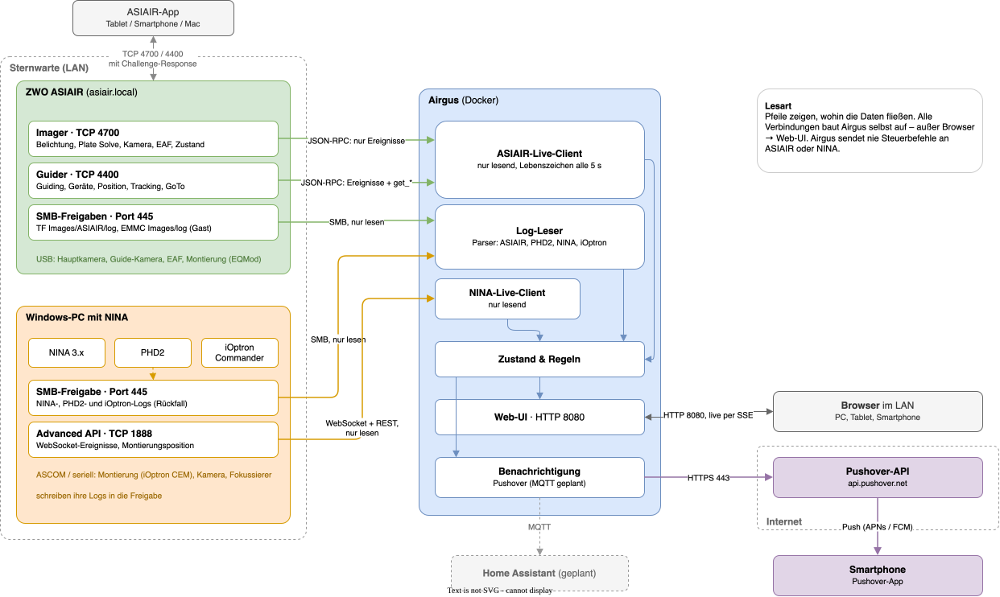
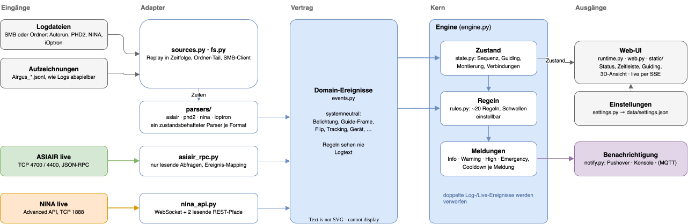

<p align="center"></p>

<p align="center"><b>Watches your imaging night and wakes you when it goes wrong.</b><br>
Live monitor for ZWO ASIAIR and N.I.N.A. – guiding, meridian flips, tracking, frozen sessions – with
alerts on your phone via Pushover.</p>

<p align="center"></p>

## Highlights

- **Reads what the rig writes** – ASIAIR Autorun, PHD2, NINA and iOptron Commander logs, straight from
  the SMB share or a folder.
- **Listens live** – to the ASIAIR's control and guider ports and to NINA's Advanced API plugin:
  guiding, exposures, mount position, tracking, flips, device drops, the moment they happen.
- **21 rules** for what actually ruins nights: runaway guide star, failed or stuck meridian flip,
  tracking off, lost star, a frozen imaging program, disconnected devices, failed autofocus …
- **Read only** – Airgus never sends a control command to the ASIAIR or NINA; it is refused in code.
- **Web UI** – live state, timeline of the night, guiding chart, 3D mount view with meridian countdown,
  replay of past nights at up to 1200× speed.
- **Runs anywhere** – Python or Docker, alerts via Pushover (Home Assistant / MQTT planned).

> **Status:** early prototype, used on real nights. The ASIAIR interface is reverse-engineered and
> undocumented; the NINA live connection is not yet tested against a running NINA.

## How it works

<p align="center"></p>

Every source is translated into the same system-neutral events (`airgus/events.py`); the rules only see
those events, never log text. Adding a system means adding one parser. When a live connection and a log
report the same thing, the log copy is dropped.

Both diagrams are draw.io files with the drawing embedded – open `docs/*.drawio.svg` in draw.io to edit them.

## Quick start

```bash
cp docker-compose.example.yml docker-compose.yml
docker compose up -d --build          # web UI on http://localhost:8080
```

or without Docker:

```bash
python3 -m venv .venv && .venv/bin/pip install -e '.[dev]'
.venv/bin/airgus --logs logs          # web UI on http://localhost:8080
```

In the web UI pick a night below the log folder and **replay** it, or switch to **live** and follow the
SMB share or a folder. Pushover keys, the ASIAIR and NINA connections and all rule thresholds are set
under *Einstellungen* and stored in `data/settings.json`; `AIRGUS_PUSHOVER_TOKEN` / `AIRGUS_PUSHOVER_USER`
override stored keys. In Docker, enter the ASIAIR's IP address: containers usually cannot resolve
`asiair.local` (mDNS).

Headless commands for scripts:

```bash
.venv/bin/airgus replay logs/2026-11-14                          # rules over a finished night
.venv/bin/airgus --config airgus.toml watch /Volumes/ASIAIR/log  # live, console output
```

## What it detects

| Rule | Detects | Severity |
|---|---|---|
| `runaway` | Guide error keeps growing although corrections are at their limit (collision, cable drag, clutch slip) | high → emergency |
| `star-lost` | Guide star lost; from the 3rd loss within an hour one summary per hour | high |
| `calibration` | Guider calibration lost its star | high / warning |
| `settle` | Repeated settle failures after dithering | warning |
| `meridian-flip` | Failed flip, endless auto-center loop, flip without pier-side change | high |
| `past-meridian` | Target tracked far past the meridian on the wrong pier side | high |
| `rms` / `snr-drop` | Rolling RMS too high / guide-star SNR falls (clouds, dew, dawn) | warning |
| `stale-log` | Sequence running but no new log lines | high |
| `capture-stalled` | No new exposure while guiding goes on – e.g. NINA frozen after a lost remote-desktop session | high |
| `tracking-off` | Tracking off during a sequence, or "Start Tracking failed" (not for flats/darks/bias, longer grace in a flip) | high |
| `plate-solve` | Plate solve failed; repeated failures escalate | info → high |
| `autofocus` | Autofocus failed | warning |
| `device-lost` | Guide camera, mount (ASIAIR) or NINA devices disconnected during a sequence | high / info |
| `main-camera` / `focuser` | Main camera state changed, EAF reopened during a sequence ¹ | warning / high |
| `mount-home` | Mount sent home or parked during a sequence ¹ | warning / info |
| `app-error` | NINA crashed, a sequence step failed | high / warning |
| `controller-health` / `wifi` | ASIAIR undervoltage, overcurrent, overheating, weak WLAN ¹ | high / warning |
| `controller-offline` | Live connection to the ASIAIR or NINA lost during a sequence ¹ | high |

¹ needs a live connection. Failures the ASIAIR or NINA write after the user stopped the sequence by hand
are not reported. Every threshold is adjustable in the web UI.

## Data sources

### Logs

| System | Files | Used for |
|---|---|---|
| ASIAIR | `Autorun_Log_*.txt` | sequence, exposures, flips, auto-center, autofocus, tracking |
| PHD2 (ASIAIR and Windows) | `PHD2_GuideLog_*.txt` | guide frames, star loss, settling, dithering, calibration |
| NINA 3.x | `YYYYMMDD-HHMMSS-<version>.<pid>-YYYYMM.log` | sequence, frames, flips, centering, autofocus, focuser, devices, crashes |
| iOptron Commander | `iOptronCommander*Log_YYYYMMDD.txt` | tracking state reported by the mount itself |

Put the logs of one night in a folder below the log folder; replay merges all files in time order.

**Live over SMB:** Airgus polls the share itself (no host mount) and reads only what was appended.
Several shares can be watched at once – default for the ASIAIR is `TF Images/ASIAIR/log` (SD card) and
`EMMC Images/log` (internal); a missing share is skipped. The ASIAIR offers guest sessions without SMB
signing; with a user name (e.g. a NINA PC) signing stays on. Only files changed within 12 h are watched.

### Live: ASIAIR (ports 4700 and 4400, experimental)

Undocumented, reverse-engineered from the ASIAIR app's traffic – may change with any firmware.

- **Port 4700 (imager):** events every client receives – exposures, plate solves, main camera and EAF
  changes, temperature, power, WLAN. Queries are answered only to the app, which logs in with a
  challenge-response (`get_verify_str` / `verify_client`, key inside the app); Airgus does not.
- **Port 4400 (guider, PHD2 event format):** guide steps, star loss, settling, tracking on/off
  (`ScopeTrack`, also by hand), home / GoTo slews once per second; polled every 5 s with read-only
  queries: `get_connected` (guide camera, mount), `scope_get_ra_dec`, `scope_get_pierside`,
  `scope_get_track_state`. Live guide frames replace the PHD2 log's frames.
- Keep-alive `test_connection` every 5 s; only `get_*` / `scope_get_*` are allowed in code.
- Messages can be recorded to `data/recordings/Airgus_ASIAIR4700_<date>.jsonl` and replayed like logs.

### Live: NINA (Advanced API plugin)

With the NINA plugin *Advanced API* (christian-photo, API v2) and its server enabled, Airgus connects to
`ws://<NINA PC>:1888/v2/socket`.

- Events: `IMAGE-SAVE` (type, exposure, target, HFR, stars), `SEQUENCE-STARTING` / `-FINISHED`,
  `SEQUENCE-ENTITY-FAILED`, `MOUNT-BEFORE-FLIP` / `-AFTER-FLIP`, `MOUNT-PARKED` / `-HOMED`,
  `AUTOFOCUS-FINISHED`, `ERROR-AF`, `ERROR-PLATESOLVE`, `CAMERA-DOWNLOAD-TIMEOUT`,
  `<DEVICE>-CONNECTED` / `-DISCONNECTED`.
- Mount position, pier side and tracking every 5 s from `/v2/api/equipment/mount/info`.
- Read only: nothing is sent over the socket; REST is limited to `/version` and `/equipment/mount/info`
  in code (the plugin also moves the mount on some GET endpoints).
- Recordings: `data/recordings/Airgus_NINA_<date>.jsonl`.

## Connections

| From → to | Connection | Carries |
|---|---|---|
| ASIAIR → Airgus | SMB 445 (guest, read only) | Autorun and PHD2 logs |
| ASIAIR → Airgus | TCP 4700, JSON-RPC | broadcast events |
| ASIAIR → Airgus | TCP 4400, JSON-RPC | guiding, devices, mount position, tracking, slews |
| NINA PC → Airgus | SMB 445 (read only) | NINA, PHD2 and iOptron Commander logs (fallback) |
| NINA PC → Airgus | TCP 1888, WebSocket + REST | live events, mount position |
| Browser → Airgus | HTTP 8080 | web UI, live updates by server-sent events |
| Airgus → Pushover → phone | HTTPS 443, then Apple / Google push | alerts from warning upwards (configurable) |
| Airgus → Home Assistant | MQTT | planned |

Airgus opens every connection itself, except the browser's.

## Web UI

- **State** – sequence, guiding, camera and focus, connections; values from a lost connection turn grey.
- **Mount** – 3D model of a Sky-Watcher Explorer 150P on an EQ6-R Pro, driven by the live mount
  position (or estimated from the PHD2 log), with pier side, hour angle and meridian countdown;
  warns on counterweight-up. Loads three.js from a CDN.
- **Timeline** – exposures, log activity, guiding and tracking of the whole night, stalls shaded, alerts
  marked.
- **Guiding chart**, alert list, settings, replay controls.

## Project layout

- `airgus/events.py` – system-neutral domain events, the contract between adapters and rules
- `airgus/parsers/` – one stateful line parser per log format
- `airgus/asiair_rpc.py`, `airgus/nina_api.py` – read-only live clients
- `airgus/sources.py`, `airgus/fs.py` – replay, live folder tail, SMB client
- `airgus/state.py`, `airgus/rules.py`, `airgus/engine.py` – state, rules, de-duplication, notification
- `airgus/runtime.py`, `airgus/web.py`, `airgus/static/` – web UI and its backend
- `docs/` – draw.io diagrams

## Roadmap

- [x] Live connection to the ASIAIR control (4700) and guider (4400) ports
- [x] Built-in SMB client for live logs
- [x] NINA and iOptron Commander logs; live events via the NINA Advanced API plugin
- [x] Web UI: state, timeline, guiding chart, alert history, settings, replay, 3D mount view
- [ ] Authentication for the web UI (binds to localhost by default)
- [ ] Home Assistant via MQTT discovery (sensors, alert events, mute/acknowledge)
- [ ] Multiple rigs in one instance, SQLite persistence
- [ ] Twilight-aware suppression of SNR / star-lost alerts

## License

GPL-3.0 – see [LICENSE](LICENSE).
